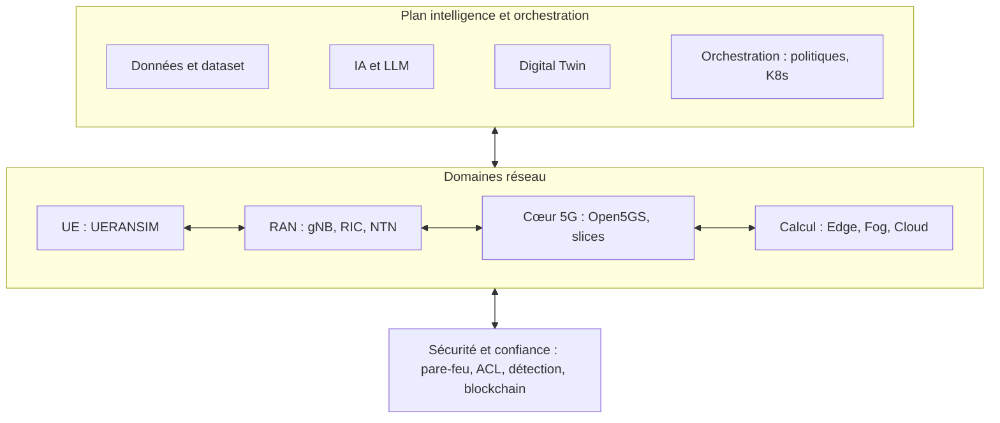

# AT1 et AT2 : environnement, différences B5G/6G et architecture 6G cible

Document de travail pour le rapport (à placer dans `documentation/` du dépôt). Les éléments « Dans notre labo » décrivent ce qui est réellement en place au 16/11/2026 ; le reste est prévu dans les ateliers indiqués.

Point d'honnêteté à reprendre dans le rapport : le cœur utilisé (Open5GS) et le RAN simulé (UERANSIM) sont des composants 5G. Les capacités « 6G » sont émulées par des couches ajoutées (contrôleurs, IA, orchestration, jumeau numérique). Le projet ne prétend pas reproduire un réseau 6G commercial.

---

## AT1 : introduction et installation de l'environnement 6G

### 1. Composants de l'environnement B5G réutilisés

| Composant | Rôle | Statut dans le labo |
|---|---|---|
| Open5GS (AMF, SMF, UPF, NSSF, NRF, SCP, UDM, UDR, AUSF) + MongoDB + WebUI | Cœur 5G standalone et base des abonnés | En place (v2.8.0) |
| UERANSIM (`nr-gnb`, `nr-ue`) | gNB et UEs simulés, liaison radio émulée par UDP | En place |
| Network namespaces + pont `br-ue` | Isoler chaque UE du cœur sur la même VM | En place (`setup-netns.sh`) |
| iperf3, ping, traceroute, `tc`, `sar`, tcpdump / tshark | Trafic, mesures QoS, charge CPU, captures | En place |
| Python (venv, pandas, scikit-learn) | Contrôleurs, analyse, IA | Contrôleurs en place ; IA à venir |
| tmux, Git (dépôt `jerbiiii/6G`) | Travail à deux, versionnage | En place |
| Docker | Conteneurs | Installé, usage à venir (AT9) |

Si l'environnement du Projet fédérateur 2 comporte d'autres éléments (par exemple Kubernetes, MEC, Prometheus), les ajouter ici avec leur statut.

### 2. Nouvelles fonctionnalités nécessaires pour la 6G

| Fonctionnalité | Atelier | Statut |
|---|---|---|
| Multi-UE et services différenciés | AT4 | Terminé |
| QoS pilotée par les données | AT5 | Terminé |
| Slicing dynamique (3 slices) | AT6 | Terminé |
| Virtualisation sur plusieurs nœuds | AT7 | À faire |
| Cloud-native et orchestration (Kubernetes) | AT8 | À faire |
| Conteneurisation des fonctions | AT9 | À faire |
| Continuum Edge / Fog / Cloud et orchestration intelligente | AT10, AT11 | À faire |
| IA à l'Edge, O-RAN et RIC | AT12, AT13 | À faire |
| Dataset, mobilité, V2X, NTN | AT14 à AT19 | À faire |
| Digital Twin, blockchain | AT20, AT21 | À faire |
| Quantique, IA générative | AT22, AT23 | À faire |
| IA prédictive, détection d'anomalies, boucle AI-native, cybersécurité | AT24 à AT27 | À faire |
| Intégration | AT28 | À faire |

### 3. Différences B5G / 6G

Remarque sur les sources : le cadre de la 6G (3GPP à partir de la Release 20, ITU IMT-2030) est en cours de définition. Vérifier les références et les dates dans les documents 3GPP et ITU avant de les citer dans le rapport.

| Domaine | B5G (5G-Advanced, Projet fédérateur 2) | 6G étudiée (Projet fédérateur 3) | Dans notre labo |
|---|---|---|---|
| Intelligence | IA ajoutée à des fonctions existantes (optimisation, analytique réseau) | AI-native : l'IA fait partie de l'architecture et pilote une boucle de décision autonome | Contrôleur Python mesurer / décider / agir (AT5, AT6) ; modèles à venir (AT24 à AT26) |
| Network slicing | Slices configurées à l'avance (S-NSSAI, DNN) | Slicing dynamique adapté à la charge et aux données | 3 slices (SST 1, 2, 3) avec DNN et interface UPF dédiés, politique `tc` statique et dynamique (AT6) |
| Cœur et virtualisation | Architecture à services (SBA), cloud-native en partie | Cloud-native complet, fonctions distribuées, orchestration automatique | Open5GS (SBA) sur une VM ; Docker et Kubernetes prévus (AT7 à AT9) |
| Calcul | MEC / Edge | Continuum Edge, Fog et Cloud avec placement intelligent des services | À faire (AT10 à AT12) |
| RAN | O-RAN et RIC en déploiement | RAN programmable et piloté par l'IA (xApps, rApps) | gNB simulée par UERANSIM ; étude et simulation de la boucle RIC prévues (AT13) |
| Mobilité et couverture | Handover, V2X (introduit avec la 5G), premiers réseaux non terrestres | Mobilité prédictive, intégration native terrestre / non terrestre | À faire (AT15 à AT19) |
| Jumeau numérique | Usage émergent | Composant à part entière pour tester une décision avant de l'appliquer | À faire (AT20) |
| Sécurité et confiance | Sécurité 5G, détection par IA | Sécurité native, confiance distribuée (blockchain étudiée), résilience face au quantique | À faire (AT21, AT25, AT27) |
| IA générative | Peu présente | Assistant d'exploitation et de configuration (LLM) | À faire (AT23) |
| Optimisation avancée | Heuristiques et ML | Optimisation quantique étudiée pour l'allocation de ressources | À faire (AT22) |

### 4. Architecture 6G cible

Voir le schéma d'architecture (AT2) ci-dessous.

### 5. Résultats AT1

- Environnement de simulation opérationnel : oui (VM AWS Ubuntu 24.04, Open5GS, UERANSIM, namespaces, outils de mesure).
- Architecture 6G définie : oui (AT2).
- Outils installés : voir le tableau du paragraphe 1.
- Différences B5G/6G identifiées : voir le tableau du paragraphe 3.

---

## AT2 : architecture et composants d'un réseau 6G

### Schéma de l'architecture cible

Trait plein : base déjà en place dans le labo. Pointillé : à ajouter.

### Composants et rôles

| Domaine | Composant | Rôle |
|---|---|---|
| Terminaux | UE, véhicules (V2X) | Accès au réseau, sessions PDU, génération de trafic |
| Radio | gNB (RU, DU, CU en O-RAN) | Accès radio et lien avec le cœur |
| Radio | Near-RT RIC et xApps | Contrôle du RAN en temps quasi réel |
| Radio | Non-RT RIC et rApps | Optimisation et politiques à plus grande échelle |
| Radio | Segment non terrestre (NTN) | Couverture par satellite, latence élevée |
| Cœur | AMF | Enregistrement, mobilité, accès |
| Cœur | SMF | Sessions PDU, allocation des adresses |
| Cœur | UPF | Plan usager, une interface par slice (`ogstun`, `ogstun2`, `ogstun3`) |
| Cœur | NSSF | Sélection de slice |
| Cœur | NRF, SCP | Découverte et communication entre fonctions |
| Cœur | UDM, UDR, AUSF | Abonnés et authentification |
| Calcul | Edge (MEC) | Traitement près des utilisateurs, faible latence |
| Calcul | Fog | Nœuds intermédiaires |
| Calcul | Cloud | Traitement central, capacité élevée |
| Intelligence | Données et dataset | Collecte des mesures, nettoyage, étiquetage |
| Intelligence | IA, LLM, optimisation quantique | Prédiction, détection d'anomalies, assistance, allocation de ressources |
| Intelligence | Digital Twin | Tester une décision sur une copie numérique avant de l'appliquer |
| Orchestration | Kubernetes, SMO, contrôleurs de politiques | Déploiement, mise à l'échelle, adaptation des ressources |
| Sécurité | Pare-feu, ACL, détection, blockchain privée | Protection, traçabilité, intégrité |

### Interfaces entre les domaines

| Interface | Entre | Protocole | Dans notre labo |
|---|---|---|---|
| Uu (radio) | UE et gNB | RRC / NAS sur liaison radio simulée | UDP, port 4997 sur le pont `br-ue` (10.100.0.0/24) |
| N2 | gNB et AMF | NGAP sur SCTP, port 38412 | Oui |
| N3 | gNB et UPF | GTP-U sur UDP, port 2152 | Oui |
| N4 | SMF et UPF | PFCP sur UDP, port 8805 | Oui |
| SBI | Fonctions du cœur | HTTP/2 via SCP et NRF | Oui (adresses 127.0.0.x, port 7777) |
| N6 | UPF et réseaux de données ou Edge | IP | Oui : `ogstun`, `ogstun2`, `ogstun3` (10.45, 10.46, 10.47) |
| E2 | gNB et Near-RT RIC | O-RAN E2AP | Non (simulation de la boucle prévue, AT13) |
| A1 | Non-RT RIC et Near-RT RIC | O-RAN A1AP | Non (AT13) |
| F1, E1 | DU, CU-CP, CU-UP | 3GPP F1AP, E1AP | Non (étude théorique) |
| Mesures et actions | Plan intelligence et réseau | Mesures par iperf3, ping, `sar` ; actions par `tc` | Oui (AT5, AT6) ; API Kubernetes prévue (AT8) |
| Orchestration | Orchestrateur et Edge / Cloud | API Kubernetes | Non (AT8, AT11) |

### Ce qui change par rapport à l'architecture B5G

- Un plan d'intelligence transversal (données, IA, jumeau numérique) qui pilote le réseau, au lieu de fonctions d'analyse isolées.
- Un continuum de calcul Edge, Fog, Cloud avec placement automatique des services.
- Un RAN programmable (RIC, xApps, rApps) et une couverture terrestre / non terrestre intégrée.
- Une sécurité et une confiance traitées comme des fonctions transversales du réseau.
